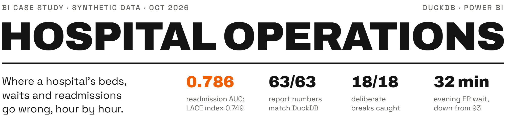

<picture>
  <source media="(max-width: 600px) and (prefers-color-scheme: dark)" srcset=".github/assets/header-phone-dark.png">
  <source media="(max-width: 600px) and (prefers-color-scheme: light)" srcset=".github/assets/header-phone-light.png">
  <source media="(prefers-color-scheme: dark)" srcset=".github/assets/header-dark.png">
  <source media="(prefers-color-scheme: light)" srcset=".github/assets/header-light.png">
  
</picture>

An end-to-end hospital operations case study: three years of a simulated 256-bed hospital in Hyderabad, modelled and tested in DuckDB, with a 30-day readmission model measured against the LACE index. The Power BI report is generated entirely from code and has two modes: the hospital at any chosen hour, and a review of any chosen period.

[Case study (PDF)](docs/case-study.pdf) · [Portfolio page](https://damanjz.github.io/portfolio/projects/hospital-operations/)

## Results

| Figure | Result | How it is produced |
|---|---|---|
| Readmission model, out-of-time test | ROC AUC 0.786 against 0.749 for the LACE index | Logistic regression in `src/model.py`, trained to September 2024, tested from April 2025; `data/model/model_metrics.csv` |
| Report numbers vs DuckDB | 63 of 63 match | `powerbi/check_report.py` compares the report with independent DuckDB queries across the whole period, filtered periods and three moments on the Now page |
| Checks tested by breaking the data | 18 of 18 deliberate breaks caught | `src/mutation_test.py` breaks a copy of the database once per check and confirms that check fails |
| Evening ER median wait | 32 minutes in FY 2025-26, down from 93 in FY 2024-25 | `mart_er_visits` in `data/model`; one extra evening ER doctor from April 2025 |
| Checks | 18 of 18 pass; the export is blocked if any fails | `sql/checks.sql`, run by `src/pipeline.py` |
| Same patients flagged as LACE | the model catches 51.4% of readmissions, LACE 47.4% | `capture_at_lace_share` in `data/model/model_metrics.csv` |
| Determinism | two full rebuilds give identical raw files, model tables and Power BI project | [How it works](docs/how-it-works.pdf) |

The first report comparison found two bugs (the left-without-being-seen rate counted visits still open at the cut-off; the ER queue showed blank instead of zero at a quiet hour). Both were fixed before all 63 matched.

## How it works

| Stage | What happens |
|---|---|
| Simulate | A seeded event simulation runs the ER queue, beds and cleaning, the roster and readmissions, and writes 9 raw exports |
| Model | DuckDB SQL builds dimensions, ER visits, admissions, bed stays and an hourly census of every unit |
| Features and ML | Index discharges, a 30-day readmission label and the LACE score, then the readmission model with calibration, fairness checks and reasons per patient |
| Marts and checks | Report tables; 18 checks gate the export of 12 tables |
| Report | `powerbi/build_pbip.py` writes the Power BI project (TMDL model, PBIR report) from the schema |

Reviewing the code? Start with [How it works](docs/how-it-works.pdf), a stage-by-stage guide with the design choices worth challenging. The case study is also a [web page](docs/case-study.html).

## What it answers


| Question | Where |
|---|---|
| Do we have beds right now, and where? | Now: bed board, beds ready and being cleaned, admitted patients waiting in the ER |
| Is the ER coping at this hour? | Now: patients waiting by triage level, longest wait, patients per nurse against target |
| When does demand peak, and are we staffed for it? | Flow: ER arrivals and median wait by weekday and hour |
| How full are the wards, month by month? | Flow: bed occupancy by unit, median wait by shift |
| Who comes back within 30 days, and why? | Readmissions: rate by diagnosis, age, length of stay and how full the unit was at discharge |
| Who should get a follow-up call today? | Readmissions: recent discharges ranked by risk, with the reasons |

Two modes: **Now** shows the hospital at any chosen hour; **Review** covers a chosen period, filtered by year, unit and age group.

## Findings

From the synthetic hospital:

- One extra evening ER doctor (April 2025) cut the evening median wait from 93 minutes to 32, and the share of evening patients leaving unseen from 13.3% to 5.7%.
- The ER's worst hour for patients per nurse is 23:00 (3.9), at the handover to a smaller night team, not the evening peak.
- Monday brings 27% more ER arrivals than Sunday; August and September about 29% more than January to March. The roster is the same all year.
- 12.8% of patients sent home come back as an emergency within 30 days: 14.3% when sent home from a unit 95% full or more, 12.3% from one under 85% full.
- The readmission model (logistic regression, out-of-time test) reaches ROC AUC 0.786 against 0.749 for the LACE index. Flagging the same number of patients as the LACE flag, it catches 51.4% of readmissions against 47.4%.

## Data

All data is synthetic: the hospital, its patients, staff and visits are simulated. Sex and payer are never model features; they are used only to check the model treats groups alike. No real patient data is used.

## Rebuild

Requirements: Python 3.12+, Power BI Desktop (free; Windows), about 480 MB of disk including the Python environment. The three build scripts run in about a minute (measured 2026-10-12 on Windows; the rebuilt tables match the committed ones).

```bash
python -m venv .venv
.venv/Scripts/pip install -r requirements.txt
.venv/Scripts/python src/generate.py
.venv/Scripts/python src/pipeline.py
.venv/Scripts/python powerbi/build_pbip.py --portable
```

Place the project at `C:\hospital-operations-bi` (or change the `DataFolder` parameter in Power BI), open `powerbi/PatientFlow.pbip` in Power BI Desktop and choose Refresh.

## Repo layout

```
src/generate.py            seeded event simulation: ER queue, beds and cleaning, roster, readmissions; 9 raw exports
sql/01_staging.sql         typed staging, resent ER rows removed
sql/02_model.sql           dimensions, ER visits, admissions, bed stays, hourly census of every unit
sql/03_features.sql        index discharges, 30-day readmission label, LACE score, feature list
src/model.py               readmission model, LACE comparison, calibration, fairness, reasons per patient
sql/04_marts.sql           report tables
sql/checks.sql             18 checks; the export is blocked if any fails
src/pipeline.py            builds DuckDB, trains the model, runs the checks, exports 12 tables to data/model
src/mutation_test.py       breaks the data on purpose, once per check, and confirms each check catches it
powerbi/build_pbip.py      generates the Power BI project (TMDL model, PBIR report) from the schema
powerbi/check_report.py    compares 63 report numbers with independent DuckDB queries
powerbi/*.ps1              validate, open, query and capture helpers for Power BI Desktop
data/                      generated raw exports and the 12 exported tables
docs/                      case study and reviewer guide (HTML and PDF), report images, charts
```

## Limits

- The hospital, its patients and staff are synthetic; costs and billing aren't modelled.
- Beds are assigned within a unit at random; real hospitals also match by sex, isolation needs and specialty.
- The roster is planned staffing; the only absence modelled is occasional uncovered sick leave.
- Power BI has no free public link, so the report ships as a project with images in the docs.
- Tested on Power BI Desktop 2.158 for Windows only.

## Licence

MIT, see [LICENSE](LICENSE).
