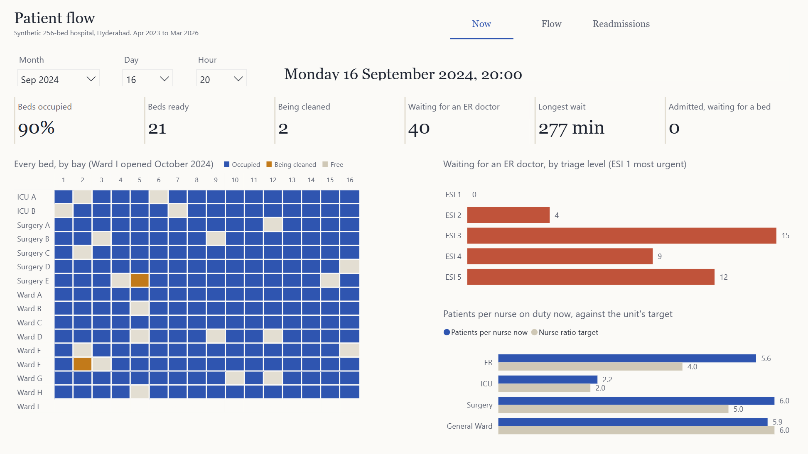

# Hospital Operations

An end-to-end hospital operations case study: three years of a simulated 256-bed hospital in Hyderabad, modelled and tested in DuckDB, a 30-day readmission model measured against the LACE index, and a Power BI report generated entirely from code.

**[Read the full case study (PDF)](docs/case-study.pdf)**, or the [web version](docs/case-study.html) for a portfolio site.
Reviewing the code? Start with **[How it works](docs/how-it-works.pdf)**, a stage-by-stage guide with the design choices worth challenging.



## What it answers

| Question | Where |
|---|---|
| Do we have beds right now, and where? | Now: bed board, beds ready and being cleaned, admitted patients waiting in the ER |
| Is the ER coping at this hour? | Now: patients waiting by triage level, longest wait, patients per nurse against target |
| When does demand peak, and are we staffed for it? | Flow: ER arrivals and median wait by weekday and hour |
| How full are the wards, month by month? | Flow: bed occupancy by unit, median wait by shift |
| Who comes back within 30 days, and why? | Readmissions: rate by diagnosis, age, length of stay and how full the unit was at discharge |
| Who should get a follow-up call today? | Readmissions: recent discharges ranked by risk, with the reasons |

Two modes: **Now** shows the hospital at any chosen hour; **Review** covers a chosen period, filtered by year, unit and age group.

## Headline findings (synthetic hospital)

- One extra evening ER doctor (April 2025) cut the evening median wait from 93 minutes to 32, and the share of evening patients leaving unseen from 13.3% to 5.7%.
- The ER's worst hour for patients per nurse is 23:00 (3.9), at the handover to a smaller night team, not the evening peak.
- Monday brings 27% more ER arrivals than Sunday; August and September about 29% more than January to March. The roster is the same all year.
- 12.8% of patients sent home come back as an emergency within 30 days: 14.3% when sent home from a unit 95% full or more, 12.3% from one under 85% full.
- The readmission model (logistic regression, out-of-time test) reaches ROC AUC 0.786 against 0.749 for the LACE index. Flagging the same number of patients as the LACE flag, it catches 51.4% of readmissions against 47.4%.

## How it's built

```
src/generate.py            seeded event simulation: ER queue, beds and cleaning, roster, readmissions; 9 raw exports
sql/01_staging.sql         typed staging, resent ER rows removed
sql/02_model.sql           dimensions, ER visits, admissions, bed stays, hourly census of every unit
sql/03_features.sql        index discharges, 30-day readmission label, LACE score, feature list
src/model.py               readmission model, LACE comparison, calibration, fairness, reasons per patient
sql/04_marts.sql           report tables
sql/checks.sql             18 checks; the export is blocked if any fails
src/pipeline.py            builds DuckDB, trains the model, runs the checks, exports 12 tables to data/model
src/mutation_test.py       breaks the data on purpose, once per check, and confirms each check catches it
powerbi/build_pbip.py      generates the Power BI project (TMDL model, PBIR report) from the schema
powerbi/check_report.py    compares 63 report numbers with independent DuckDB queries
powerbi/*.ps1              validate, open, query and capture helpers for Power BI Desktop
```

Every number is checked twice: the SQL checks reconcile the data (no bed holds two patients, every stay joins end to end, the hourly census matches a direct count, readmission flags match a recount), and 63 report numbers were compared with DuckDB for the whole period, filtered periods and three moments on the Now page.

## Run it

Requirements: Python 3.12+, Power BI Desktop (free; Windows).

```bash
python -m venv .venv
.venv/Scripts/pip install -r requirements.txt
.venv/Scripts/python src/generate.py
.venv/Scripts/python src/pipeline.py
.venv/Scripts/python powerbi/build_pbip.py --portable
```

Place the project at `C:\hospital-operations-bi` (or change the `DataFolder` parameter in Power BI), open `powerbi/PatientFlow.pbip` in Power BI Desktop and choose Refresh.

## Data

All data is synthetic: the hospital, its patients, staff and visits are simulated. Sex and payer are never model features; they are used only to check the model treats groups alike. No real patient data is used.
